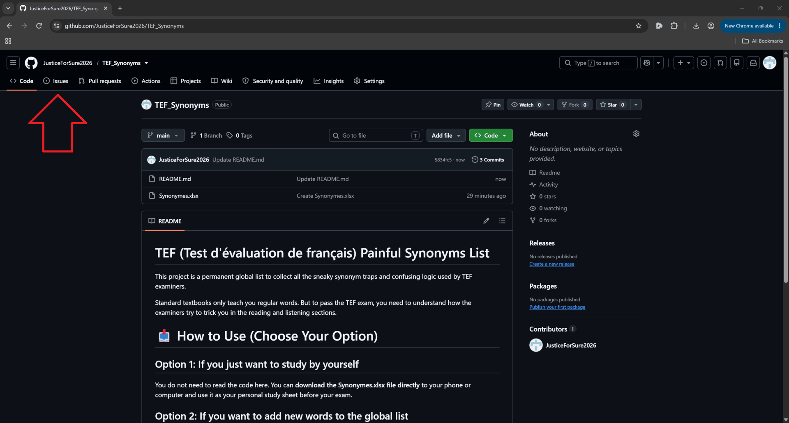
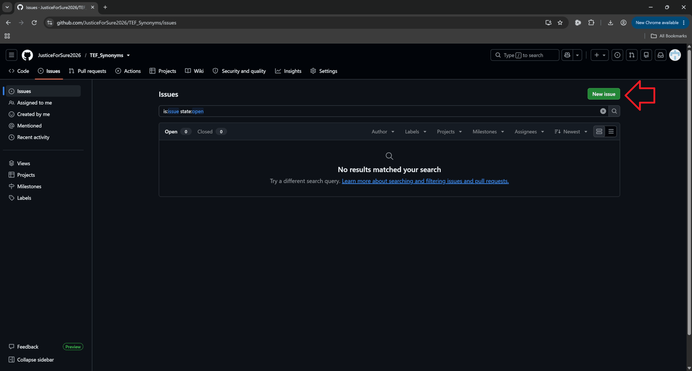
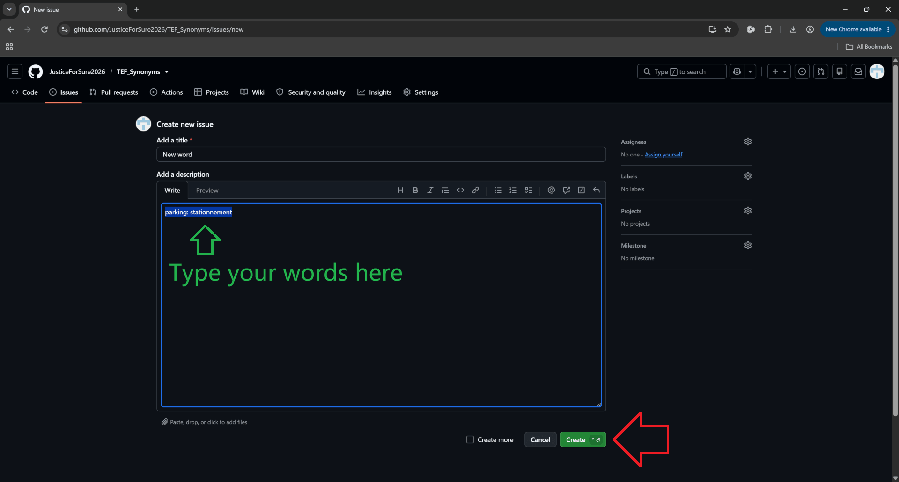

# TEF (Test d'évaluation de français) Synonyms List

<h2 style="border-bottom: none;">🚨 Have you suffered from tricky, painful synonyms during your exam?</h2>

### 💡 "Synonym": Different words = Same idea

### 💥 Quick Example: How examiners try to trick you

| Text / Audio uses... | But Correct Answer uses... | English |
| :--- | :--- | :--- |
| **gaspiller** | ➔ **dilapider** / **gâcher** | waste |
| **pénurie** | ➔ **manque** / **disette** | lack |
| **abroger** | ➔ **abolir** / **supprimer** | abolish / cancel |

<h3 style="font-weight: bold;">
This global list aims to collect as many synonyms as possible to help you memorize them effectively.
</h3>

 

> # 🔥 Currently collected: 
> ## 📊 [ 72 Nouns ] • [ 124 Verbs ] • [ 66 Adjectives ]
> Contribute to update this permanent list by sharing the tricky traps 🪤 you encountered.

* Standard textbooks only teach you regular words. 
* To pass the TEF exam, you need to understand the sneaky synonym traps and confusing logic designed by TEF examiners in the reading and listening sections.

# 📥 How to Use (Choose Your Option)

## Option 1: If you just want to study by yourself
You do not need to read the code here. You can <mark>**📥 download the 📋 "Synonymes.xlsx" file directly**</mark> or  from Google Sheets
>  https://docs.google.com/spreadsheets/d/1NEdQnEnFzXDOrbpADH2Xr_T4ShmFJDxIp30IdhIymLs/edit?usp=sharing

to your phone or computer and use it for your personal study.

> ℹ️ **Note on File Formats:** Both `Synonymes.csv` and `Synonymes.xlsx` contain the exact same content. `Synonymes.csv` is provided specifically for fast online viewing and searching directly on GitHub without downloading.

## Option 2: If you want to add new words to the global list
When you finish your TEF exam and encounter an unknown, painful word or a ridiculous trap, feel free to contribute to the community.

> ### 📢 NOTICE: Anyone in the world 🌍 can submit. No technical skill or programming background needed. This is a global shared list 📜.
> ### 🛑 For simplicity, no Pull Requests or Commits are used here. "Creating an Issue" is the ONLY way to report a new word.

* You can **request to add new synonyms to the list by clicking the "Issues" tab at the top and creating a new issue**. 
* Just type the words you saw and what the trap was. The owner will update the main list for everyone.

### 📸 Step-by-Step Tutorial: How to Submit a New Word

Follow this simple image guide to report a new synonym trap:

1. **Step 1:** Click on the **Issues** tab.
  

2. **Step 2:** Click the green **New Issue** button on the right side.
  

3. **Step 3:** Type the painful words or ridiculous logic traps you encountered during your TEF exam, then click **Create**.
  

4. **Step 4:** All done.