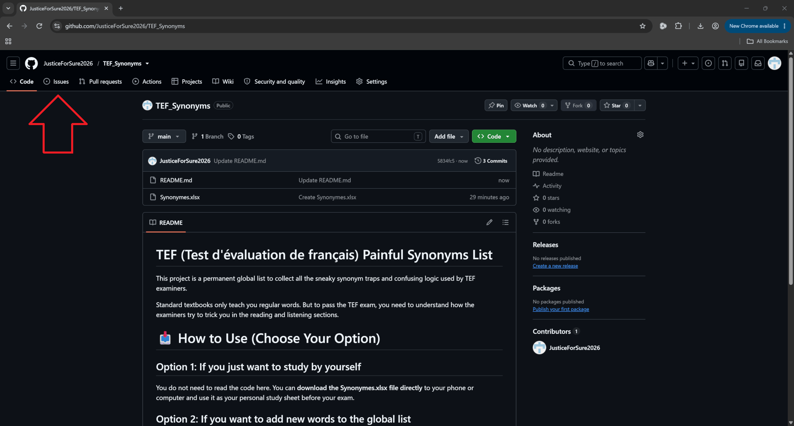
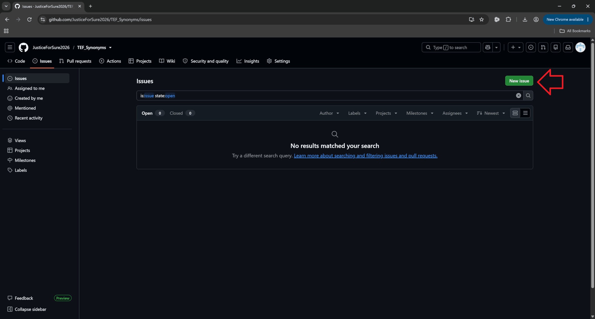
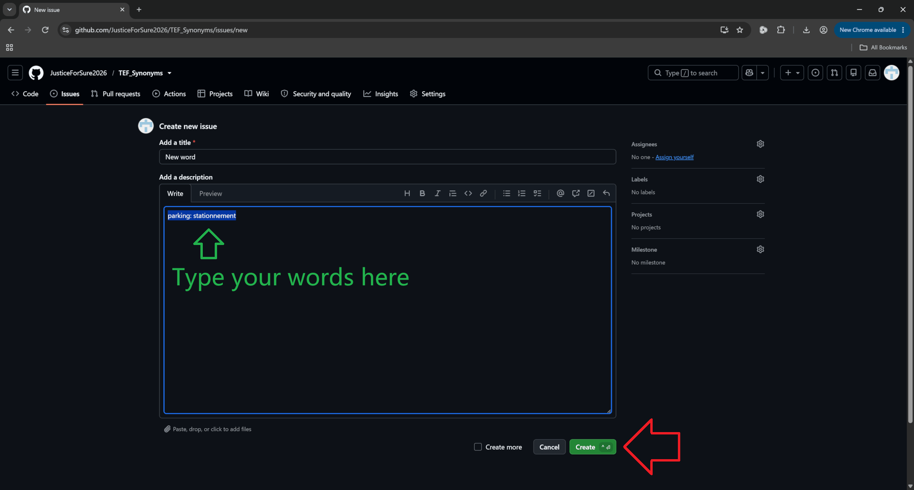

# TEF (Test d'évaluation de français) Painful Synonyms List

> # 🔥 Currently collected: 
> ## 📊 [ 39 Nouns ] • [ 0 Verbs ] • [ 0 Adjectives ]
> Contribute to expand the list by sharing the tricky traps 🪤 you encountered.

This project is a permanent global list to collect all the sneaky synonym traps and confusing logic used by TEF examiners. 

Standard textbooks only teach you regular words. But to pass the TEF exam, you need to understand how the examiners try to trick you in the reading and listening sections.

# 📥 How to Use (Choose Your Option)

## Option 1: If you just want to study by yourself
You do not need to read the code here. You can **download the Synonymes.xlsx file directly** to your phone or computer and use it as your personal study sheet before your exam.

> ℹ️ **Note on File Formats:** Both `Synonymes.csv` and `Synonymes.xlsx` contain the exact same content. `Synonymes.csv` is provided specifically for fast online viewing and searching directly on GitHub without downloading.

## Option 2: If you want to add new words to the global list
When you finish your TEF exam and encounter an unknown, painful word or a ridiculous trap, feel free to contribute to the community.

> ### 📢 NOTICE: Anyone in the world 🌍 can submit. No technical skill or programming background needed. This is a global shared list 📜.
> ### 🛑 For simplicity, no Pull Requests or Commits are used here. "Creating an Issue" is the ONLY way to report a new word.

* You can **request to add new synonyms to the list by clicking the "Issues" tab at the top and creating a new issue**. 
* Just type the words you saw and what the trap was. The owner will update the main list for everyone.

### 📸 Step-by-Step Tutorial: How to Submit a New Word

Follow this simple image guide to report a new synonym trap:

1. **Step 1:** Click on the **Issues** tab.
  

2. **Step 2:** Click the green **New Issue** button on the right side.
  

3. **Step 3:** Type the painful words or ridiculous logic traps you encountered during your TEF exam, then click **Create**.
  

4. **Step 4:** All done.